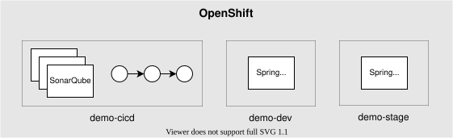
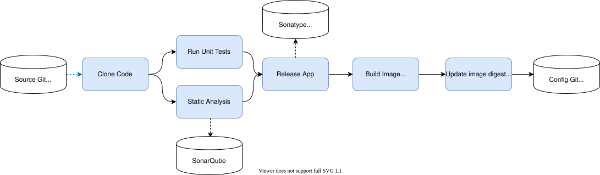
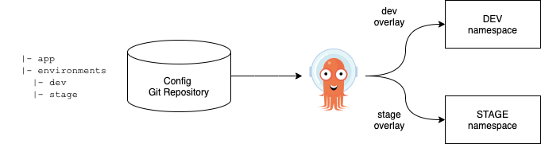
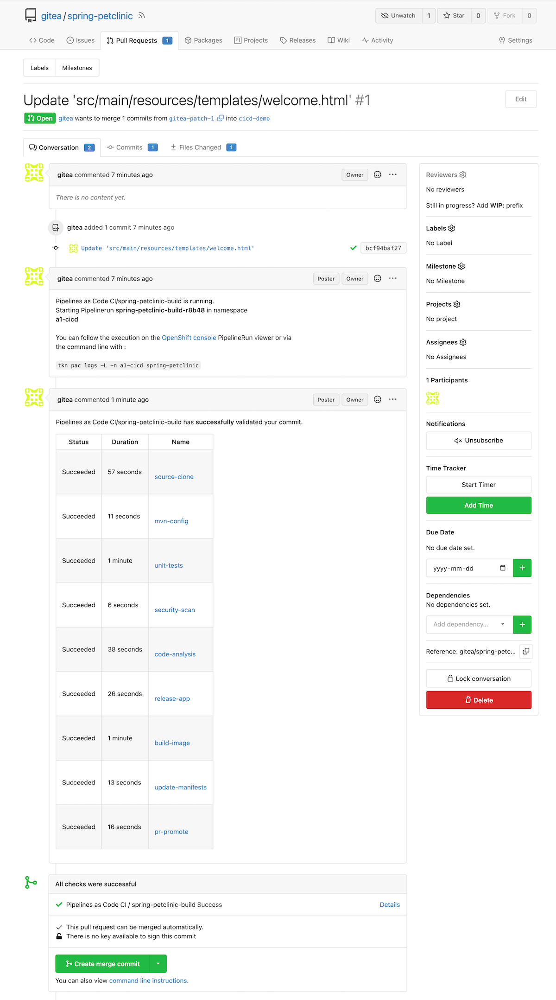
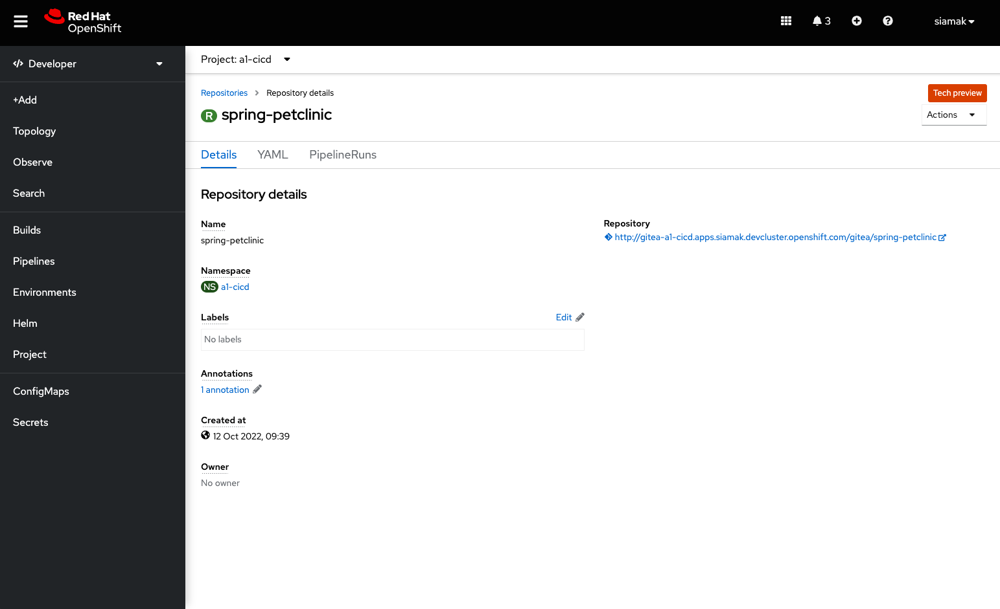
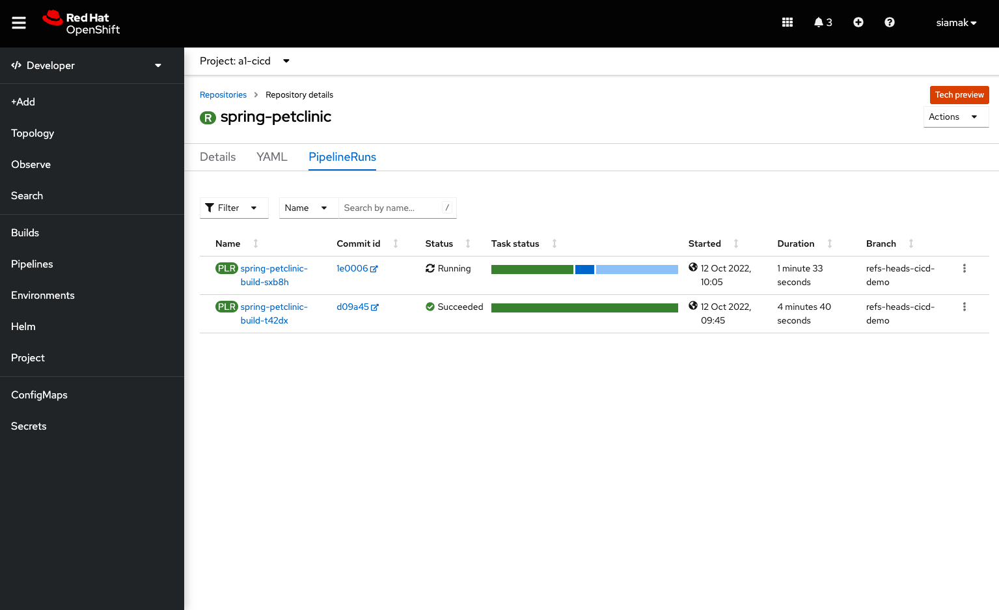
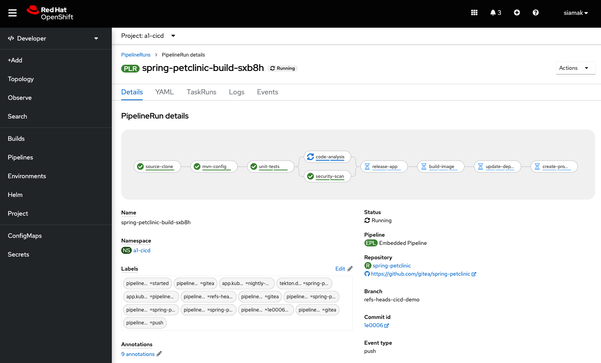
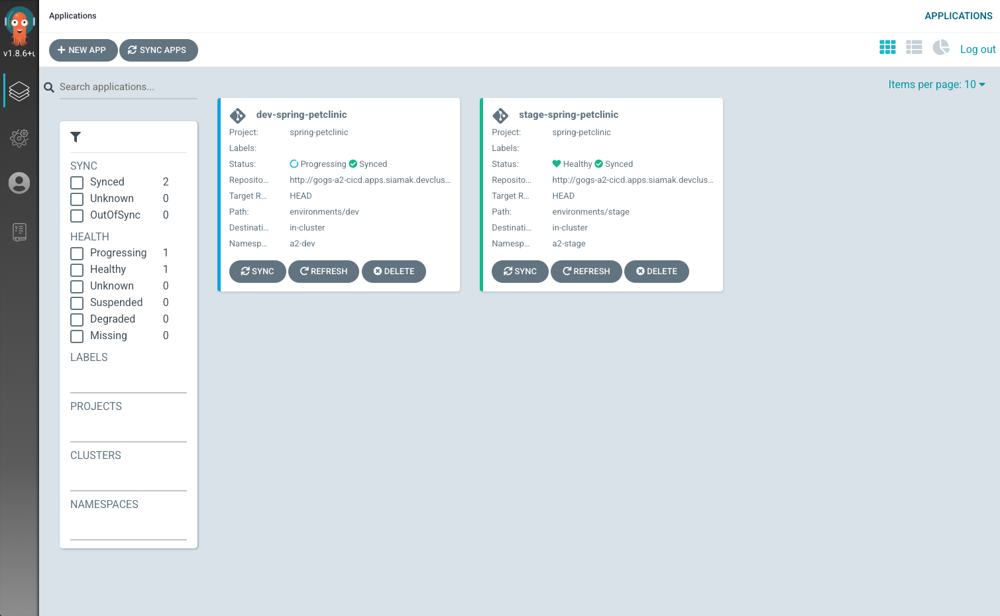
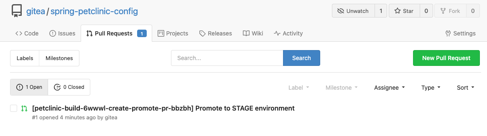

# About this fork

This work is a fork of https://github.com/siamaksade/openshift-cicd-demo for on-premises virtualized OpenShift demo environments, including SNO and OpenShift Local (AKA CRC). The installers support the OpenShift-generated router CA, a user-provided private CA bundle, or an already trusted/public CA. They can also configure a user-provided wildcard certificate and private key for the default Ingress Controller.

If using the demo on Codeready Containers (OpenShift Local) on Windows 11, set your WSL2 to use mirror network mode so that the ingress controller can be reached from the host. This is done by creating the following in the WSL2 config file `$HOME/.wslconfig`.

```ini
[wsl2]
networkingMode=mirrored
```

The cluster-wide trusted CA bundle and the certificate served by Ingress are separate settings:

* `proxy/cluster.spec.trustedCA` adds private CA certificates to the trust used by cluster components for HTTPS connections.
* `IngressController.spec.defaultCertificate` selects the TLS identity presented by routes that do not define their own certificate.

The scripts configure these settings according to the options described below. They do not modify the trust store of the machine from which you run the installer. For browser and CLI access outside this script, import a private CA into that machine's trust store separately.


# CI/CD Demo with Tekton and Argo CD on OpenShift

This repo is a CI/CD demo using [Tekton Pipelines](http://www.tekton.dev) for continuous integration and [Argo CD](https://argoproj.github.io/argo-cd/) for continuous delivery on OpenShift which builds and deploys the [Spring PetClinic](https://github.com/spring-projects/spring-petclinic) sample Spring Boot application. This demo creates:

* 3 namespaces for CI/CD, DEV and STAGE projects
* 1 Tekton pipeline for building the application image on every Git commit and pull-request
* Argo CD (login with OpenShift credentials)
* Gitea git server (username/password: `gitea`/`openshift`)
* Sonatype Nexus (username/password: `admin`/`admin123`)
* SonarQube (username/password: `admin`/`admin`)

The Gitea workload uses the upstream rootless image and remains under
OpenShift's restricted SCC. Its writable runtime directories are ephemeral;
the database and Git repositories remain on persistent volumes.

<p align="center">
  
</p>

## Tested Configuration

* OpenShift Local (CRC) with OpenShift 4.22.1
* OpenShift GitOps 1.21.1
* OpenShift Pipelines 1.23.1

## CA and Ingress TLS options

The CA mode controls both cluster trust and the Git TLS environment used by the
installer:

| Mode | Cluster trust | Custom Ingress certificate validation | Installer HTTPS clients |
| --- | --- | --- | --- |
| `router` (default) | Reads `openshift-ingress-operator/router-ca`, stores it in `openshift-config/custom-ca`, and references that ConfigMap from `proxy/cluster.spec.trustedCA`. | Not accepted; select `file` or `none` explicitly for a custom certificate. | Preserves the historical demo posture: Git uses `GIT_SSL_NO_VERIFY=true` and the bounded Gitea readiness probe uses `curl --insecure`. |
| `file` | Uses the complete PEM CA bundle supplied through `--ca-file` or `-CaFile`. The default ConfigMap name is `<prefix>-trusted-ca`. | Validates the certificate chain against the supplied CA bundle. | Git uses `GIT_SSL_CAINFO` and the Gitea readiness probe uses `curl --cacert` with that file. |
| `none` | Leaves `proxy/cluster.spec.trustedCA` unchanged. | When a custom certificate is supplied, validates its chain against `openshift-config-managed/trusted-ca-bundle`; the required CA must already be present in that managed cluster bundle. | Leaves inherited Git trust variables unchanged; `curl` uses its normal inherited/system trust configuration. |

When the installer detects that curl uses the Windows Schannel backend, it adds
`--ssl-no-revoke` only to the bounded Gitea readiness probe. This avoids
`CRYPT_E_NO_REVOCATION_CHECK` in environments without a reachable revocation
service, but disables certificate revocation checks for that probe. Certificate
chain and hostname verification still follow the selected CA mode.

On an implicit default `router` rerun, an already referenced `custom-ca` is not
overwritten. The installer verifies that it contains the current router CA and
that the managed bundle and cluster operators are stable. If it does not contain
that CA, the run fails. Pass `--ca-mode router` or `-CaMode router` explicitly to
refresh it from `router-ca`.

To change the certificate served by Ingress, explicitly select `file` or `none`
and provide both the certificate chain and matching private key. The PEM chain is
strictly validated in this order: a non-CA leaf (`CA:FALSE`), zero or more CA
intermediates, and a self-signed root CA. Each certificate must be signed by the
next certificate in the file, and the leaf must include the exact wildcard SAN
`*.<ingress-domain>`, such as `*.apps.<cluster>.<domain>`. The private key must be
PEM encoded, unencrypted, and match the leaf. These requirements follow the
[OpenShift procedure for replacing the default Ingress certificate](https://docs.redhat.com/en/documentation/openshift_container_platform/4.21/html/security_and_compliance/configuring-certificates#replacing-the-default-ingress-certificate_configuring-certificates).

OpenSSL 1.1.1 or newer is required and enforced when using a CA file or a custom
Ingress certificate. Before making cluster changes, both installers parse every
certificate, reject private keys mixed into CA/certificate bundles, check
expiration, verify the wildcard SAN, key and strict chain, and ask `oc` to render
the TLS Secret with client-side dry-run. Never copy a private key into this
checkout or commit it to Git; reference it from a protected location outside the
repository.

Both entry points disable statement tracing (`set +x` or `Set-PSDebug -Off`) so
trace output cannot reveal key material. Do not re-enable tracing during
installation; if PowerShell tracing was intentionally active beforehand,
re-enable it explicitly after the script finishes.

Examples with Bash:

```shell
# Historical behavior: use the OpenShift-generated router CA.
./demo.sh install

# Certificate issued by a public CA already trusted by the cluster and local host.
./demo.sh install --ca-mode none \
  --ingress-tls-cert /secure/pki/wildcard-chain.pem \
  --ingress-tls-key /secure/pki/wildcard.key

# Certificate issued by a private corporate CA.
./demo.sh install --ca-mode file \
  --ca-file /secure/pki/corporate-ca-bundle.pem \
  --ingress-tls-cert /secure/pki/wildcard-chain.pem \
  --ingress-tls-key /secure/pki/wildcard.key
```

Equivalent PowerShell examples:

```powershell
.\demo.ps1 install

.\demo.ps1 install -CaMode none `
  -IngressTlsCert C:\secure\pki\wildcard-chain.pem `
  -IngressTlsKey C:\secure\pki\wildcard.key

.\demo.ps1 install -CaMode file `
  -CaFile C:\secure\pki\corporate-ca-bundle.pem `
  -IngressTlsCert C:\secure\pki\wildcard-chain.pem `
  -IngressTlsKey C:\secure\pki\wildcard.key
```

The custom TLS Secret defaults to
`<prefix>-ingress-tls-<sha256-12>`, where the suffix is the first 12 hexadecimal
characters of the SHA-256 digest over the ordered DER certificate chain. The
full chain digest is recorded in the Secret annotation
`openshift-cicd-demo-certificate-chain-sha256`. This gives any changed leaf,
intermediate, or root certificate a new default Secret name and makes the
Ingress Controller reconcile a new reference.
An explicitly named Secret supplied through `--ingress-tls-secret` or
`-IngressTlsSecret` must either not exist or already carry the same full chain
digest annotation, TLS Secret type, canonical certificate chain, and
cryptographically matching private key. A matching existing Secret is reused
without rewriting its key material; use a new Secret name if the certificate
chain or key changes. The scripts also reject local certificate/key files that
change after initial validation.

Override the CA ConfigMap name with `--ca-configmap` in Bash or `-CaConfigMap` in
PowerShell. The scripts configure only `IngressController/default`, because it
admits the routes created by this demo. If `proxy/cluster` already references a
different CA ConfigMap, the installer fails instead of silently replacing it;
reuse that referenced name only with the complete intended bundle.

The `start` command accepts `--ca-mode`/`--ca-file` or
`-CaMode`/`-CaFile` as local Git connection settings; it does not change cluster
trust or Ingress. This lets a later `start` invocation reuse a private CA file.
The CA ConfigMap and Ingress certificate options remain install-only.

These are cluster-wide changes. Updating the default Ingress certificate affects all routes that rely on it, and changing the trusted CA can restart node services temporarily. The scripts use bounded waits for the managed trust bundle, MachineConfigPools, relevant ClusterOperators, and the default Ingress Controller. `uninstall` does not revert the CA, TLS Secret, or Ingress Controller configuration.

## Continuous Integration

On every push or pull-request to the `spring-petclinic` git repository on Gitea git server, the following steps are executed within the Tekton pipeline:

1. Code is cloned from Gitea git server and the unit-tests are run
1. Unit tests are executed and in parallel the code is analyzed by SonarQube for anti-patterns, and a dependency report is generated
1. Application is packaged as a JAR and released to Sonatype Nexus snapshot repository
1. A container image is built in DEV environment using S2I, and pushed to OpenShift internal registry, and tagged with `spring-petclinic:[branch]-[commit-sha]` and `spring-petclinic:latest`
1. Kubernetes manifests are updated in the Git repository with the image digest that was built within the pipeline
1. A pull-requested is created on config repo for merging the image digest update into the STAGE environment



## Continuous Delivery

Argo CD continuously monitor the configurations stored in the Git repository and uses [Kustomize](https://kustomize.io/) to overlay environment specific configurations when deploying the application to DEV and STAGE environments.



## Install Demo

1. Get an OpenShift cluster via https://try.openshift.com
1. Install OpenShift Pipelines and OpenShift GitOps operators 
1. Download [OpenShift CLI](https://mirror.openshift.com/pub/openshift-v4/clients/ocp/latest/) and [OpenShift Pipelines CLI](https://mirror.openshift.com/pub/openshift-v4/clients/pipeline/latest/), and ensure `git` and `curl` are installed. OpenSSL 1.1.1 or newer is also required for user-provided CA or certificate files.
1. Run the install script

    ```text
    $ oc new-project demo
    $ git clone https://github.com/siamaksade/openshift-cicd-demo
    $ demo.sh install
    ```
## Credentials
* Nexus: `admin`/`admin123`
* Gitea: `gitea`/`openshift`
* SonarQube: `admin`/`sonarqube`

## Demo Instructions
1. Go to spring-petclinic Git repository in Gitea
1. Log into Gitea with username/password: `gitea`/`openshift`
1. Edit a file in the repository and commit to trigger the pipeline. Alternatively, create a pull-request instead to see the result on the deployed app before merging.
1. Check the pipeline run logs in Dev Console or Tekton CLI:

   ```text
   $ opc pac logs -n demo-cicd
   ```

1. Once the pipeline finishes successfully, the image reference in the `spring-petclinic-config/environments/dev` are updated with the new image digest and automatically deployed to the DEV environment by Argo CD. If Argo CD hasn't polled the Git repo for changes yet, click on the "Refresh" button on the Argo CD application.

1. Login into Argo CD dashboard and check the sync history of `dev-spring-petclinic` application to verify the recent deployment

1. Go to the pull requests tab on `spring-petclinic-config` Git repository in Gitea and merge the pull-requested that is generated for promotion from DEV to STAGE

1. Check the sync history of `stage-spring-petclinic` application in Argo CD dashboard to verify the recent deployment to the staging environment. If Argo CD hasn't polled the Git repo for changes yet, click on the "Refresh" button on the Argo CD application.














## Troubleshooting

**Q: Why am I getting `unable to recognize "tasks/task.yaml": no matches for kind "Task" in version "tekton.dev/v1beta1"` errors?**

You might have just installed the OpenShift Pipelines operator on the cluster and the operator has not finished installing Tekton on the cluster yet. Wait a few minutes for the operator to finish and then install the demo.


**Q: why do I get `Unable to deploy revision: permission denied` when I manually sync an Application in Argo CD dashboard?**

When you log into Argo CD dashboard using your OpenShift credentials, your access rights in Argo CD will be assigned based on your access rights in OpenShift. The Argo CD instance in this demo is [configured](https://github.com/siamaksade/openshift-cicd-demo/blob/main/argo/argocd.yaml#L21) to map `kubeadmin` and any users in the `ocp-admins` groups in OpenShift to an Argo CD admin user. Note that `ocp-admins` group is not available in OpenShift by default. You can create this group using the following commands:

```
# create ocp-admins group
oc adm groups new ocp-admins

# give cluster admin rightsto ocp-admins group
oc adm policy add-cluster-role-to-group cluster-admin ocp-admins

# add username to ocp-admins group
oc adm groups add-users ocp-admins USERNAME
```
